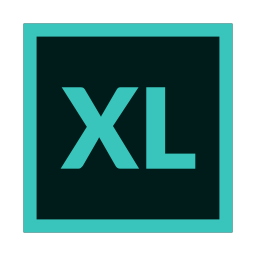
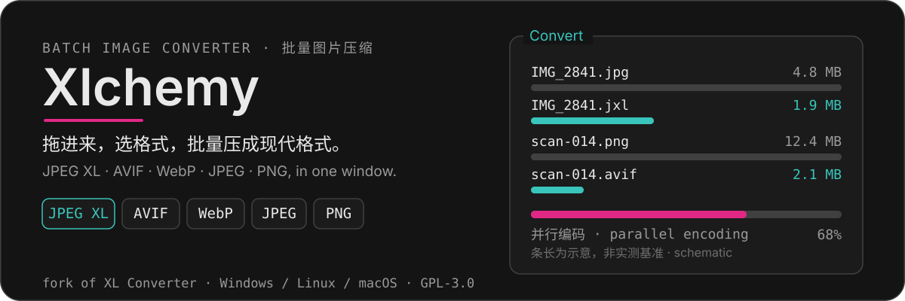
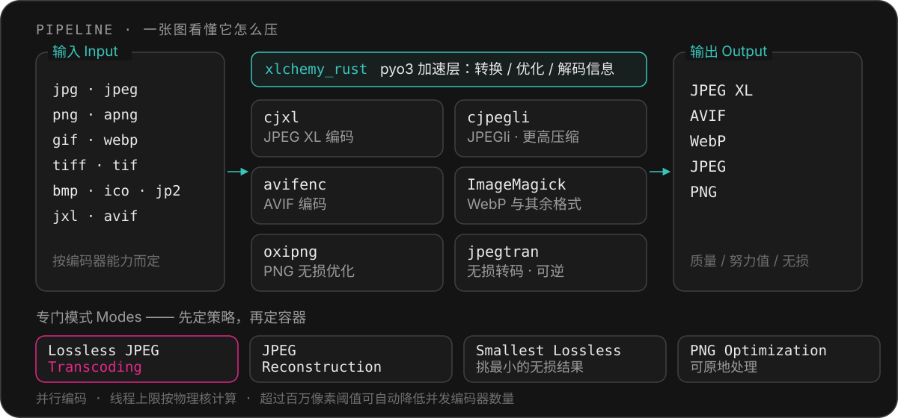

<p align="center">
  
</p>

<p align="center">
  
</p>

<p align="center">
  
  
  
  
  
  
  
  
</p>

<p align="center">
  <a href="README.md"><b>中文</b></a> · <b>English</b> · <a href="https://xl-docs.codepoems.eu">Manual</a>
</p>

---


A batch image converter in one window: drop in photos and screenshots, pick a format, and get **JPEG XL / AVIF / WebP / JPEG / PNG** — or a **reversible lossless** shrink. It drives the real encoders (`cjxl`, `cjpegli`, `avifenc`, ImageMagick, Oxipng, `jpegtran`) instead of reimplementing them, and it is a fork of [XL Converter](https://github.com/JacobDev1/xl-converter) based on upstream `stable` **v1.3.0**.

### What the fork adds

| Addition | Detail |
| --- | --- |
| **Fluent UI shell** | A closable seam on `PySide6-Fluent-Widgets`; Miku / Ralsei / Dark Amber / Light Amber themes plus an optional follow-system light/dark switch |
| **Classic shell kept** | `XLCHEMY_UI=classic` restores the upstream interface shown in the hero image above |
| **Rust bindings** | `xlchemy_rust` (pyo3) handles conversion, optimization and image-info decoding |
| **macOS builds** | `.app` and `.dmg` (Apple Silicon arm64 by default; `XL_MAC_UNIVERSAL2=1` for universal2), with dylib staging scripts |
| **Simplified Chinese UI** | `zh_CN` catalog behind a verifiable i18n seam (`task i18n:check`) |
| **Taskfile + uv workflow** | One command to create the environment, build the extension and run tests |

### Mechanism

<p align="center">
  

The pipeline diagram is the short version: encoders run in parallel with thread caps derived from **physical** cores; a memory-pressure rule can drop concurrent encoders to 1 or a chosen fraction once an image exceeds a megapixel threshold; ExifTool carries metadata across; and lossless JPEG transcoding re-quantizes no pixels, so it stays reversible.

### Features

- **JPEGli** — fully compatible JPEGs with up to [35% better compression ratio](https://opensource.googleblog.com/2024/04/introducing-jpegli-new-jpeg-coding-library.html).
- **Modern formats** — JPEG XL and AVIF for the deepest cuts; WebP, JPEG and PNG also supported.
- **Lossless JPEG transcoding** — 16%–22% smaller, reversible.
- **Downscaling** — by resolution, percent, shortest/longest side, or megapixels.
- **PNG optimization mode** — lossless Oxipng pass, adjustable effort, in-place option.
- **Specialized modes** — Lossless JPEG Transcoding, JPEG Reconstruction, Smallest Lossless (picks the smallest lossless result among PNG / WebP / JPEG XL).
- **Process priority, presets, conflict policies** — yield CPU, save settings, handle name collisions, optionally move originals to trash.

Per-encoder input acceptance is listed in [支持的格式](README.md#支持的格式) (Chinese).

### Quick start

```bash
git clone https://github.com/HibernalGlow/Xlchemy.git
cd Xlchemy
task setup   # environment → dependencies → Rust extension → self-check
task run     # launch
task test    # unit tests; pass through args: task test -- -k theme
```

External encoders are compiled separately with `make deps`; bundled releases ship them. Full Windows, Linux and macOS source-build steps and the test commands are in the collapsible sections of [README.md](README.md#快速开始) (Chinese).

### License

GNU General Public License v3, inherited from upstream XL Converter — see [LICENSE.txt](LICENSE.txt). Third-party notices live in [LICENSE_3RD_PARTY.txt](LICENSE_3RD_PARTY.txt). Please read [CONTRIBUTING.md](.github/CONTRIBUTING.md) before opening issues or pull requests.
